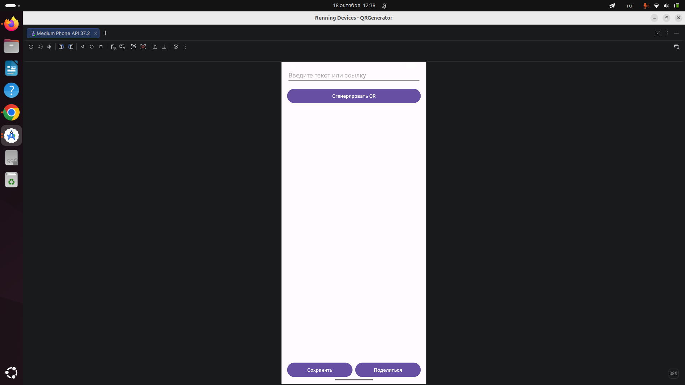
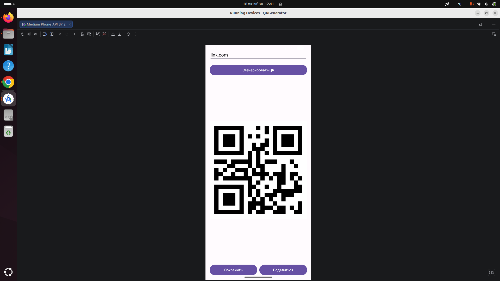
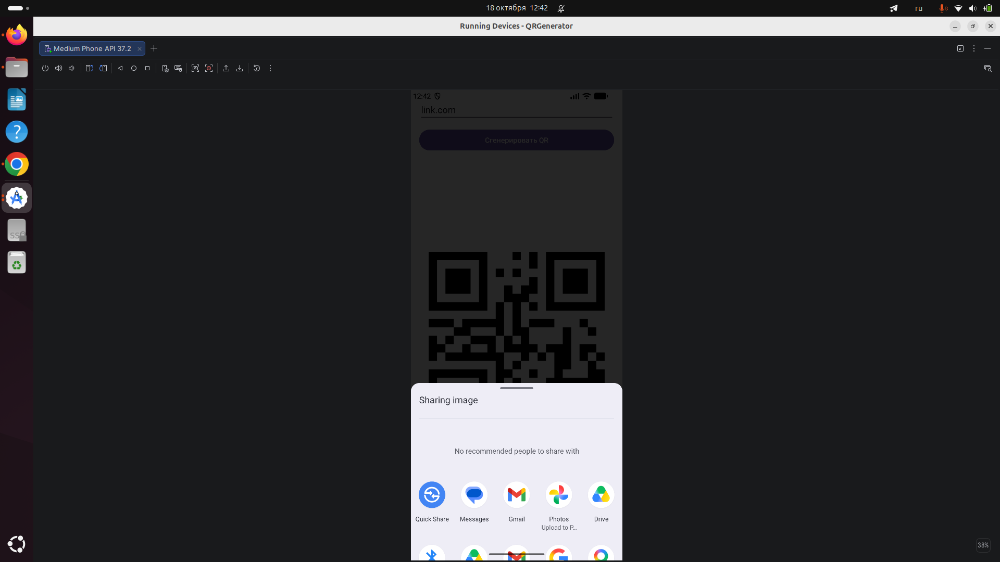
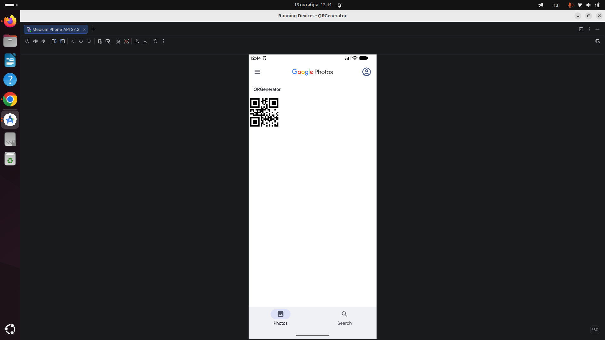

# QR Code Generator (Android)

An Android application that generates QR codes from text or URLs and lets the user save them as image files or share them through other apps.

Developed as **Task 1 (Easy) – QR Code Generator Android App** of the Auspify Technologies internship.

## Features

- Text and URL input
- QR code generation (UTF-8 supported, so non-Latin text such as Russian or Kyrgyz works)
- QR code displayed inside the app
- Save the QR code as a PNG image to the device gallery (`Pictures/QRGenerator`)
- Share the QR code through any app that accepts images (messengers, email, etc.)
- Input validation and user-friendly error messages

## Screenshots

| Main screen | Generated QR | Share dialog | Saved in gallery |
|---|---|---|---|
|  |  |  |  |

## Tech Stack

- **Language:** Kotlin
- **UI:** XML layouts with View Binding
- **QR generation:** [ZXing](https://github.com/zxing/zxing) core library (`com.google.zxing:core:3.5.3`)
- **Saving images:** `MediaStore` on Android 10+ (no permission required); direct file write with `WRITE_EXTERNAL_STORAGE` permission on Android 9 and below
- **Sharing:** `Intent.ACTION_SEND` with `FileProvider`

## How It Works

1. The user enters text or a URL and taps **Generate**.
2. `QrGenerator` encodes the text into a bit matrix with ZXing and converts it into a `Bitmap`.
3. The `Bitmap` is displayed in an `ImageView` and kept in memory.
4. **Save:** `QrStorage` writes the image as a PNG file to the gallery.
5. **Share:** `QrSharer` writes a temporary PNG to the app cache, exposes it through `FileProvider`, and starts the system share dialog.

## Project Structure

```
app/src/main/
├── java/com/example/qrgenerator/
│   ├── MainActivity.kt     # Screen logic: input, buttons, user feedback
│   ├── QrGenerator.kt      # Text -> QR Bitmap
│   ├── QrStorage.kt        # Saving the QR image to the gallery
│   └── QrSharer.kt         # Sharing the QR image via other apps
├── res/
│   ├── layout/activity_main.xml
│   ├── values/strings.xml
│   └── xml/file_paths.xml  # FileProvider configuration
└── AndroidManifest.xml
```

## Requirements

- Android Studio (recent stable version)
- Android 7.0 (API 24) or higher <!-- проверь: minSdk в app/build.gradle.kts -->

## Run the Project

1. Clone the repository:
```
   git clone https://github.com/feruzaaaaa/QRGenerator.git
```
2. Open the project in Android Studio and wait for the Gradle sync to finish.
3. Run the `app` configuration on an emulator or a physical device.

A ready-to-install debug APK is available in the repository's **Releases** section. <!-- оставь эту строку, только если загрузишь APK (Шаг 5) -->

## Author

Feruza — [GitHub](https://github.com/feruzaaaaa)